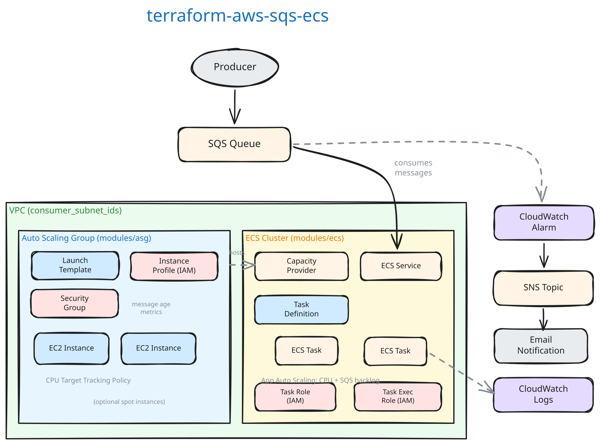

# Architecture

## Overview

This module creates an SQS queue and an ECS service backed by EC2 instances to process queue messages.



## Components

### SQS Queue

The module creates an SQS queue with server-side encryption enabled.
The queue supports both standard and FIFO modes.

### Dead-letter Queue

With `enable_dead_letter_queue = true`, the module creates a second queue,
`<queue>-dlq` (`<queue>-dlq.fifo` for a FIFO queue, since SQS requires a FIFO
queue's dead-letter queue to be FIFO too), encrypted as the queue is:

- The queue's redrive policy (`aws_sqs_queue_redrive_policy`) moves a message
  there when consumers have received it `dead_letter_queue_max_receive_count`
  times (5 by default) without deleting it. SQS moves it on the receive after
  that.
- The dead-letter queue's redrive allow policy admits only the module's queue.
- It keeps messages 14 days, SQS's maximum. A standard queue's message keeps
  its original enqueue time when it moves, so it has at least 10 days there
  after the queue's 4.
- The CloudWatch alarm `<dead-letter queue>-depth-alarm` emails
  `alert_notification_email`, through the message-age alarm's SNS topic, when
  the dead-letter queue holds any message
  (`ApproximateNumberOfMessagesVisible > 0` over 5 minutes). Without data it
  keeps its state: SQS stops publishing an idle queue's metrics.

On a FIFO queue, a message that moves to the dead-letter queue leaves its
message group, and the group's later messages are processed without it. Leave
the option off if they must never be.

By default there is no dead-letter queue: a message that consumers keep failing
on returns to the queue after each visibility timeout until it expires.

### ECS Service

The ECS service runs consumer containers as tasks on EC2 instances.
Each task pulls messages from the SQS queue and processes them.
The task definition includes:

- Consumer container with configurable CPU/memory quotas
- CloudWatch agent sidecar for metrics collection
- Optional EFS and local volume mounts
- Secret injection from AWS Secrets Manager

### EC2 Auto Scaling Group

The ASG provides EC2 instances that host ECS tasks. Key features:

- ECS-optimized AMI (latest by default)
- Optional spot instance support with configurable on-demand base capacity
- Scales based on CPU utilization

### Task Placement

The module calculates `tasks_per_instance` based on the EC2 instance
type's CPU/memory and the task's resource quotas. This determines how
many tasks can run on each instance, accounting for:

- Host OS memory reservation (1 GB)
- CloudWatch agent container resources (128 CPU units, 256 MB memory)
- Consumer task CPU and memory quotas

## Auto-Scaling

Two scaling policies work together:

### CPU-Based Scaling (ECS)

Targets average CPU utilization across all tasks (default: 60%). When CPU exceeds the target, ECS adds more tasks.

### SQS Backlog Scaling (ECS)

Monitors the ratio of visible messages to running tasks. When the
backlog per task exceeds the target (default: 100 messages), ECS
scales up.

### ASG Scaling

The ASG scales to provide enough EC2 capacity for the desired number of ECS tasks, calculated as:

```
asg_desired = ceil(ecs_task_count / tasks_per_instance)
```

## IAM Roles

- **Task Role** - Attached to the running container. Add policies for SQS access, S3, DynamoDB, etc.
- **Task Execution Role** - Used by ECS agent to pull images and write logs.
- **Instance Profile** - Attached to EC2 instances for ECS cluster registration.
